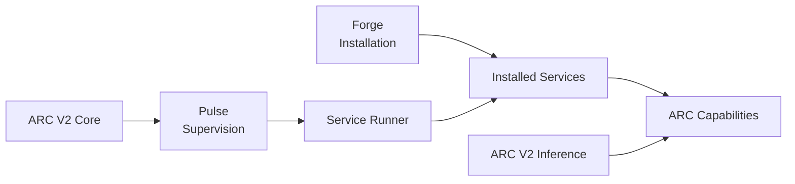

 

# ARC-V2-AI

**Building local AI, one problem at a time.**

*Local-first · Service-oriented · Built in the open*

 

---

## What is ARC-V2-AI?

> [!NOTE]
> ARC V2 is a personal open-source project exploring how to make local AI more useful through independent services, persistent processes and practical system architecture.

ARC originally stood for **Action & Reasoning Core**. What started as an experiment with giving local models the ability to reason and act has gradually grown into a larger project: building the systems around a local AI assistant.

I'm interested in the parts that make these systems work beyond a single model conversation: installation, service supervision, process execution, persistent state and communication between components.

Working with limited hardware also means making compromises. Smaller models, limited VRAM and performance constraints are part of the process. Rather than trying to compete with large cloud-based systems, I want to explore what can be achieved with the resources available.

ARC V2 is an ongoing experiment in making the most of that hardware, one problem at a time.

> [!TIP]
> **Explore the project**
>
> Visit the [ARC V2 website](https://arc-v2-ai.github.io/) for an overview of the project, its architecture, components and current direction.

### System architecture

---

### Explore the project

**[Documentation Site](https://arc-v2-ai.github.io/ARC-V2-Docs/)** · **[Architecture Principles](#architecture-principles)**

---

## Architecture Principles

These are the ideas I try to follow when building ARC V2.

<table>
<tr>
<td width="50%" valign="top">

### Local-first

I prefer computation, state and services to run locally, where resources and data remain under the user's control.

</td>
<td width="50%" valign="top">

### Service-oriented

I prefer focused services with explicit contracts over coupling every capability into one large application.

</td>
</tr>
<tr>
<td width="50%" valign="top">

### Clear boundaries

Installation, supervision, execution and application capabilities should have separate responsibilities. Keeping those boundaries clear makes the system easier to understand and work on.

</td>
<td width="50%" valign="top">

### Linux-native

Linux is my primary development environment and the foundation for ARC V2. I use system-level primitives where they make sense rather than introducing unnecessary abstractions.

</td>
</tr>
</table>

---

### Building an ARC V2 Service

**[Building an ARC V2 Service](https://github.com/ARC-V2-AI/.github/blob/main/docs/BUILDING-A-SERVICE.md)**

A guide to creating, packaging, installing and developing an independently installable ARC V2 service.

---

**ARC-V2-AI**

*Building local AI, one problem at a time.*

Independent open-source development · Built in the open

