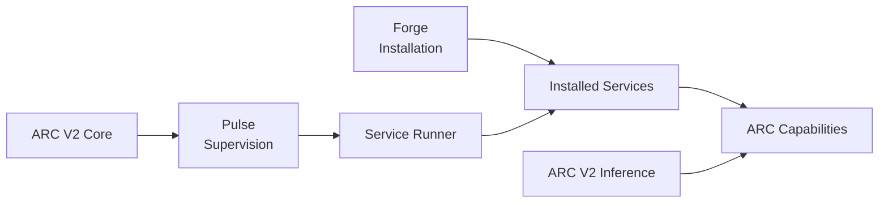

# ARC-V2-AI

**Building the systems around local AI.**

*Local-first · Service-oriented · Persistent by design*

 

---

## What is ARC-V2-AI?

> [!NOTE]
> ARC-V2-AI develops the system architecture and infrastructure for **persistent local AI environments**, rather than isolated model interfaces.

The projects make capabilities composable: components can be installed independently, run as services, supervised through their lifecycle, and connected through explicit interfaces.

> [!IMPORTANT]
> The current architecture is centred around **ARC V2**.

### System architecture

---

### Explore the project

**[Development Guides](#development-guides)** · **[Architecture Principles](#architecture-principles)**

---

## Architecture Principles

<table>
<tr>
<td width="50%" valign="top">

### Local-first

AI computation, state, and services should be able to operate locally and remain under the user's control.

</td>
<td width="50%" valign="top">

### Service-oriented

Capabilities are implemented as focused services with explicit contracts rather than coupled into one monolithic runtime.

</td>
</tr>
<tr>
<td width="50%" valign="top">

### Clear boundaries

Installation, supervision, execution, and application capabilities are separate concerns, each with a defined responsibility.

</td>
<td width="50%" valign="top">

### Linux-native

ARC V2 is designed around Linux as its primary operating environment and uses system-level primitives where they provide a stronger foundation than platform-agnostic abstractions.

</td>
</tr>
</table>

---

## Development Guides

Resources for creating and extending ARC V2 components.

### Building an ARC V2 Service

**[Building an ARC V2 Service](https://github.com/ARC-V2-AI/.github/blob/main/docs/BUILDING-A-SERVICE.md)**

A guide to creating, packaging, installing, and developing an independently installable ARC V2 service.

---

**ARC-V2-AI**

*Building the systems around local AI.*

